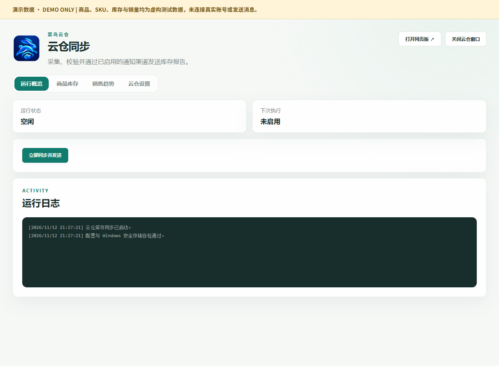
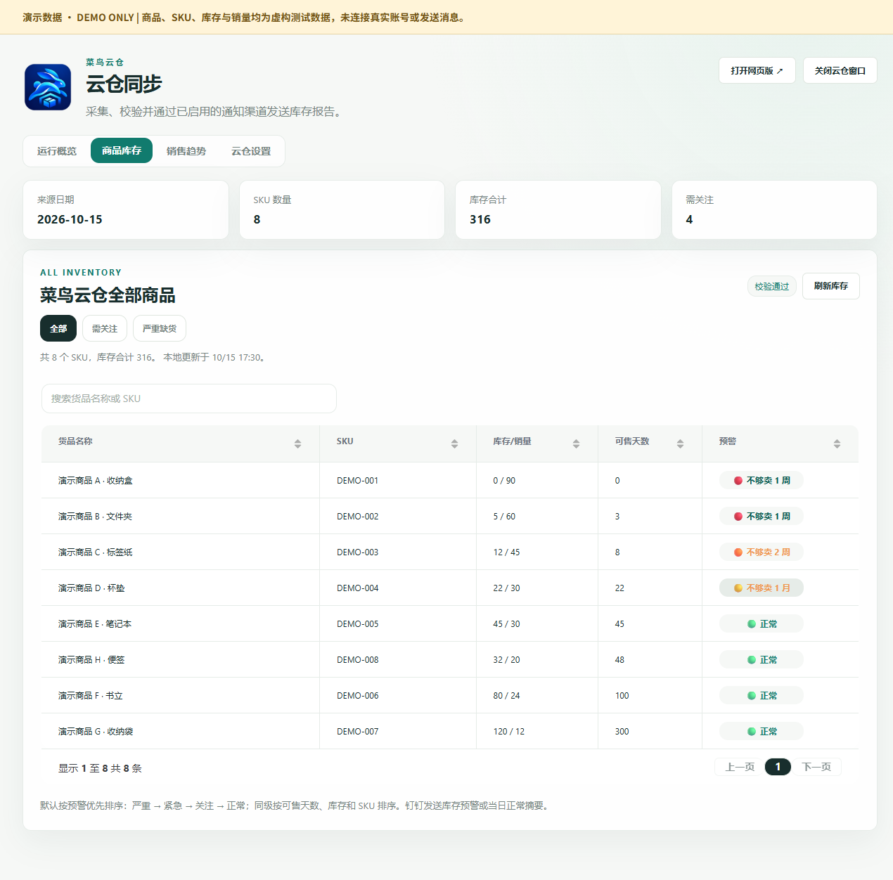
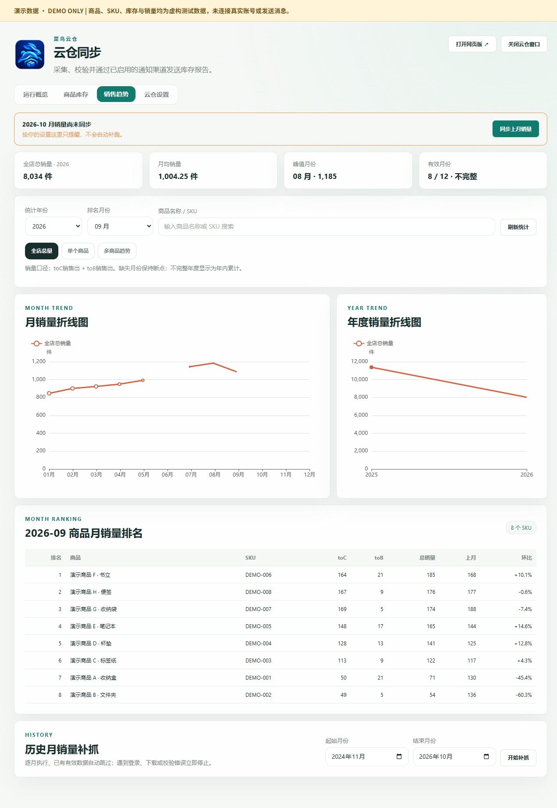
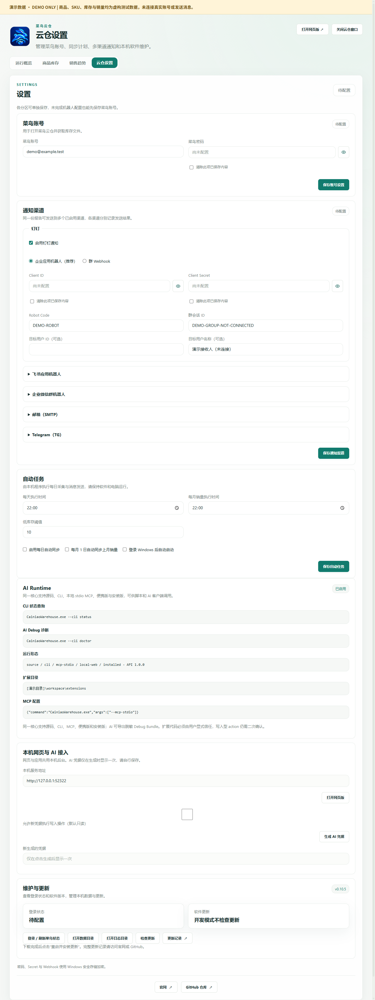

# Cainiao Cloud Warehouse

[简体中文（默认）](README.md) | **English**

[**Releases · Downloads**](https://github.com/907609732/cainiao-inventory/releases)

Cainiao Cloud Warehouse is an independent inventory application for **Windows x64** and **fnOS x86-64**. It does not require an ERP or the former e-commerce workbench. The current stable release is **0.10.5**.

> Versions 0.9.3 and 0.9.4 were withdrawn because their installation identity conflicted with the old workbench. Do not install them or run their uninstallers on a computer affected by that conflict; back up and restore the workbench first.

## Download

- [Windows 0.10.5 installer](https://github.com/907609732/cainiao-inventory/releases/download/v0.10.5/CainiaoWarehouse-Setup-0.10.5-x64.exe)
- [fnOS installer, matching container image, checksums and acceptance record](https://github.com/907609732/cainiao-inventory/releases/tag/v0.10.5)
- [fnOS installation guide](deploy/fnos/README.en.md)

Version 0.10.5 shortens product names in notification reports to roughly eight Chinese characters or sixteen ASCII characters, adding an ellipsis when needed. Full product names remain in the inventory data; SKUs and alert values are retained. fnOS opens in an embedded desktop window and supports explicitly configured application domains.

## Features

| View | Purpose |
| --- | --- |
| Overview | Task status, next scheduled run, logs and manual synchronization |
| Inventory | Saved inventory, source date, SKU search, sorting, stock coverage and replenishment alerts |
| Sales trends | Monthly/yearly warehouse outbound quantities, product rankings, single-product and multi-product comparisons |
| Settings | Cainiao account, notification channels, schedules, maintenance, update status and official links |

DingTalk, Feishu application bots, WeCom group bots, SMTP email and Telegram can be enabled together. Each channel has its own delivery outcome. Saving settings does not send a message. Additional channels default to disabled. Secrets are stored encrypted; fnOS supports explicitly revealing individual saved secrets with an eye button.

Inventory validation runs before normal synchronization and delivery. An older source date can be handled through a separate, confirmed exception flow when its other checks pass. See [notification details (Chinese)](docs/notifications.md) and [date exceptions (Chinese)](docs/date-exception-send.md).

Refreshing inventory or statistics reads saved data. Warehouse outbound quantities are not store revenue. Missing months remain gaps rather than being treated as zero sales.

## UI preview — synthetic data only

These screenshots were regenerated from the **0.10.5 source UI** using an isolated temporary ledger: eight fictional DEMO products, 316 inventory units, invented sales and a placeholder account. Passwords and secrets are empty. No production data or user-provided business screenshots are used. The application UI shown is Chinese; this English documentation does not add an English UI locale.

### Overview

Inspect task status, the next scheduled run and logs. Schedules are disabled in the demo.



### Inventory

Search and sort products, inspect source dates, stock coverage and replenishment alerts.



### Sales trends

Review monthly/yearly trends, valid months and rankings. Missing months stay visible as gaps.



### Settings

Configure accounts, notifications and schedules; inspect maintenance/update status and official links. All secrets in the screenshot are empty.



[UI guide and single/multi-product examples](docs/ui-guide.en.md). A demo “validation passed” label is a seeded display state, not evidence of a real collection or delivery.

## Independent installation and data

| Platform | Installation and data |
| --- | --- |
| Windows | App ID `com.wucheng.cainiao.warehouse`; executable `CainiaoWarehouse.exe`; per-user `%LOCALAPPDATA%\Programs\CainiaoWarehouse` or all-users `C:\Program Files\CainiaoWarehouse`; data `%APPDATA%\cainiao-cloud-warehouse` |
| fnOS | Separate `cainiao-warehouse` application/container; its private application directory is mounted at `/data` |

The application has its own shortcuts and uninstall identity. It does not automatically inherit ERP settings, browser profiles or ledgers. Configure the Cainiao account and notification targets separately. Windows uninstall preserves app data. Back up fnOS data and choose to retain it when uninstalling.

Windows and fnOS keep separate datasets; automatic bidirectional replication is not provided. Enable a report schedule on only one instance when both use the same destination.

## App, browser and AI access

Windows provides APP and web shortcuts sharing one Electron backend. Use **Open web version** in the app to establish a browser session. Closing the window or browser leaves the backend running; use the tray to exit. Read-only AI credentials are the default; write access requires an explicit choice.

fnOS can run continuously in the background, with an embedded desktop window or browser access. Web port: `18761`. The independently authenticated API on host port `18762` is loopback-only. See the [fnOS guide](deploy/fnos/README.en.md) and [Windows local web/API reference (Chinese)](docs/local-web.md).

## Run from source

Use Windows, npm and preferably **Node.js 24**, matching release CI. From the repository root:

```powershell
npm --prefix windows/workbench ci --workspaces=false
node windows/workbench/node_modules/electron/install.js
npm run dev
```

`npm test` runs regression checks, `npm run test:ui` checks the desktop UI, and `npm run build` builds the installer. Ordinary launches use the standalone data directory; automated tests use temporary ledgers. See [Windows development](windows/README.en.md).

## Release verification

Release source commit: `d1e71bf864e331b7820b5d7fb1dcfc77cebb6983`.

- [Windows CI](https://github.com/907609732/cainiao-inventory/actions/runs/43225609395): regression and UI checks passed.
- [Packaged Windows acceptance](https://github.com/907609732/cainiao-inventory/actions/runs/43225618054): fresh installation, upgrade from 0.9.7, reinstall, separate uninstall identity, synthetic data/settings preservation and shared APP/web backend passed. The old workbench baseline download was unavailable; this release did not repeat a live workbench coexistence test.
- [fnOS build acceptance](https://github.com/907609732/cainiao-inventory/actions/runs/43225609303): Linux container, four-view UI, access boundaries, restart and offline restore checks passed. Version 0.10.5 had already been accepted on the authorized NAS with inventory/settings preserved; these formal artifacts were not deployed again.
- Release assets include `SHA256SUMS.txt` and `acceptance.json`. The Windows installer digest was checked against `latest.yml`.

Release tests use isolated synthetic data and do not trigger real Cainiao collection or notification delivery. Actual delivery to additional providers requires configured accounts and recipient verification. The Windows installer is not Authenticode-signed.

## Documentation and license

- [UI guide](docs/ui-guide.en.md)
- [Windows development](windows/README.en.md)
- [fnOS installation, updates and backups](deploy/fnos/README.en.md)
- [Notifications (Chinese)](docs/notifications.md)
- [Local web and AI API (Chinese)](docs/local-web.md)
- [Architecture and data boundaries (Chinese)](docs/architecture.md)

Application source is in `windows/workbench`; fnOS packaging is in `deploy/fnos`. See the relevant dependency notices. [MIT License](LICENSE).
