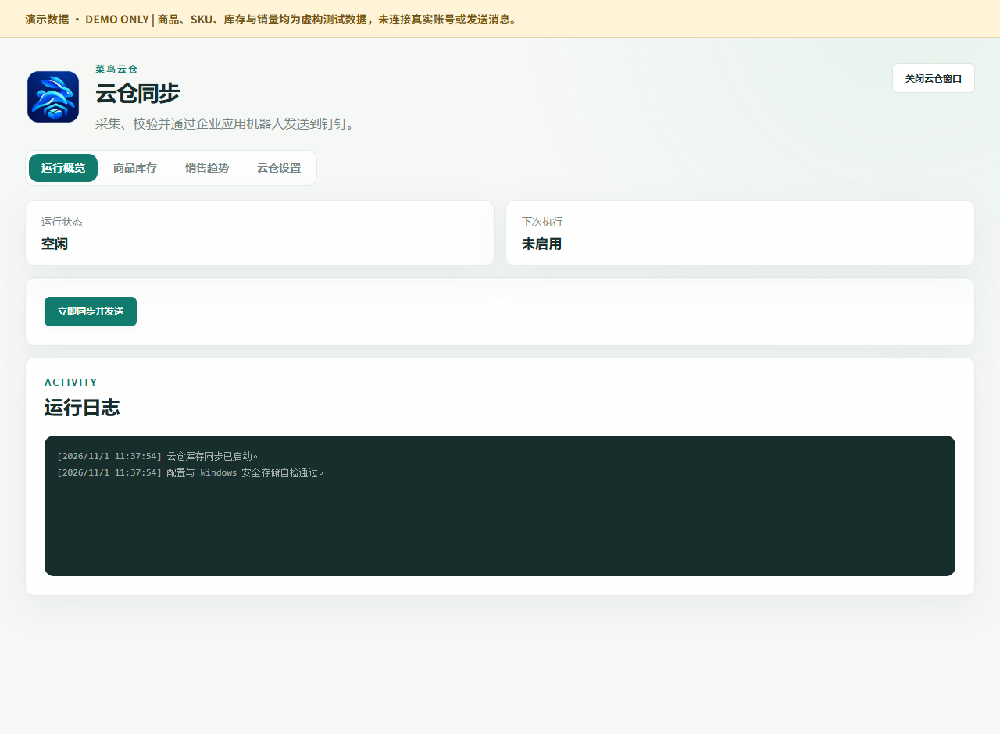
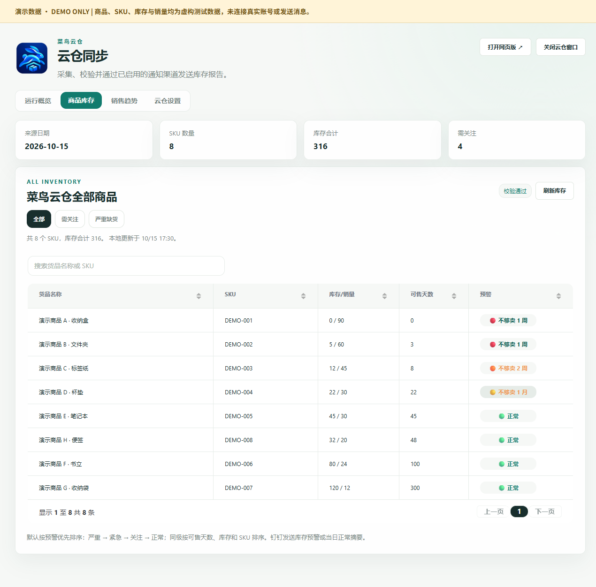
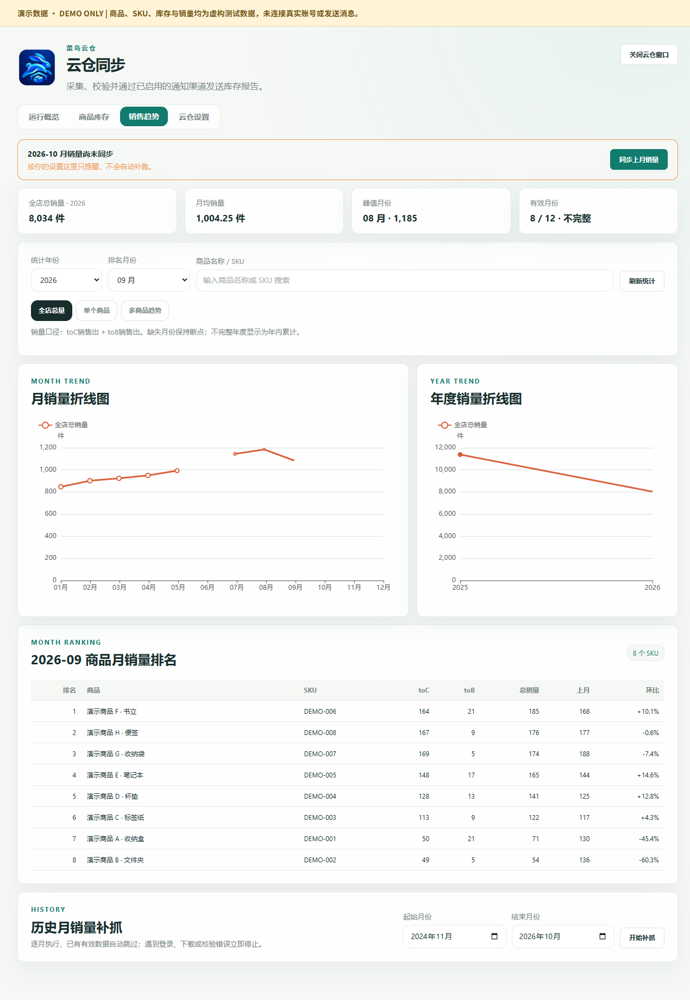
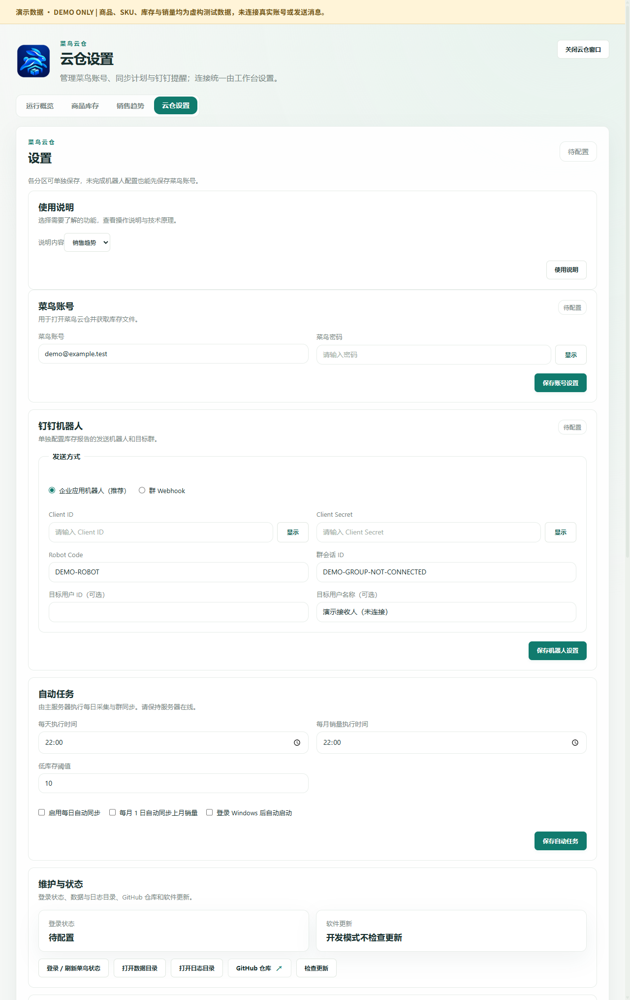

# 菜鸟云仓

**简体中文（默认）** | [English](README.en.md)

[**Releases · 下载安装包**](https://github.com/907609732/cainiao-inventory/releases)

> **0.9.3、0.9.4 已撤回，请勿继续安装。** 旧包复用了电商工作台的安装身份，存在覆盖风险。已发生覆盖时不要直接运行旧卸载程序，应先备份并恢复工作台。

当前正式版为 **0.10.6**，提供 Windows x64 和飞牛 x86-64 安装包。菜鸟云仓与五成电子商务工作台是两款独立软件，分别安装、配置和卸载。

设置页集中维护与更新，并新增飞书、企业微信、邮箱和 Telegram 多渠道通知，支持同时启用；日期偏旧但其他校验通过时，可二次确认后[特殊发送](docs/date-exception-send.md)。见[配置及验证范围](docs/notifications.md)。

0.10.6 的通知报告保留完整货品名称并换行，表头“可售 / 天数”分两行；钉钉中的 SKU 和库存/销量使用小字号，数字和预警保留完整。飞牛桌面内嵌打开，支持配置应用域名、后台定时任务及按需显示已保存密钥。Windows 提供 APP、网页版和 AI 接口。本文的英文版是项目文档翻译，不代表软件界面已支持英文切换。

## 下载

[下载 0.10.6 Windows x64 安装器](https://github.com/907609732/cainiao-inventory/releases/download/v0.10.6/CainiaoWarehouse-Setup-0.10.6-x64.exe) · [飞牛安装包与配套镜像](https://github.com/907609732/cainiao-inventory/releases/tag/v0.10.6) · [飞牛安装说明](deploy/fnos/README.md)

## 独立安装与数据

菜鸟云仓可独立运行，不依赖 ERP 或电商工作台。Windows 安装身份为 `com.wucheng.cainiao.warehouse`，程序为 `CainiaoWarehouse.exe`，使用独立快捷方式和卸载项。

| 平台 | 程序与数据 |
| --- | --- |
| Windows | 程序安装到 `%LOCALAPPDATA%\Programs\CainiaoWarehouse` 或全用户的 `C:\Program Files\CainiaoWarehouse`；数据保存在 `%APPDATA%\cainiao-cloud-warehouse` |
| 飞牛 fnOS | 独立应用 `cainiao-warehouse` 和容器；数据位于飞牛分配的应用私有目录，容器内映射为 `/data` |

首次使用需单独配置菜鸟账号和通知目标，不自动读取或迁移 ERP 的设置、登录资料或账本。Windows 卸载保留应用数据；飞牛卸载时应保留数据并先做好外部备份。

## 当前功能

| 页面 | 用途 |
| --- | --- |
| 运行概览 | 查看任务状态、日志，按配置同步并发送 |
| 商品库存 | 查看已保存库存、筛选预警商品和补货需求 |
| 销售趋势 | 查看云仓月度出库销量、排名及趋势 |
| 云仓设置 | 配置菜鸟登录、多渠道通知及自动化，集中维护与更新 |

刷新库存与统计只读取已保存数据。云仓销量不等于店铺销售额，缺失月份不能当作零销量。

## 界面预览（全部为虚构测试数据）

以下截图从 0.10.5 源码界面重新生成，使用 8 个 DEMO 商品和独立临时账本。未读取正式业务数据，未使用用户业务截图；账号为测试占位，密码与密钥均留空。每张图片均标有“演示数据”。

### 运行概览

查看运行状态、下次执行时间和任务日志；按配置手动同步。演示自动任务已关闭。



### 商品库存

查看库存汇总、来源日、可售天数和补货预警，支持搜索、排序及严重缺货筛选。图中 8 个虚构 SKU 合计 316 件。



### 销售趋势

查看月度 / 年度曲线、有效月份和商品排名，支持单品及多商品比较。缺失月份保留断点，云仓销量不等于店铺收入。



### 云仓设置

分别配置菜鸟账号、钉钉机器人和自动任务，集中查看登录状态、当前版本及软件更新。底部提供官网与 GitHub 仓库入口，完整更新记录通过外部页面查看。截图为设置页节选，所有密钥为空。



[查看完整 UI 功能演示、单品 / 多商品截图和演示数据说明](docs/ui-guide.md)。截图中的“校验通过”为预置演示状态，不代表真实采集或投递已完成。

## 应用、网页与 AI 调用

Windows 应用、浏览器和 AI 共用后台、四个页面及独立数据。APP 右上角可直接“打开网页版”。浏览器入口和受控 REST/MCP 配置见[本机网页与 AI 接口](docs/local-web.md)，安装包见 [Releases](https://github.com/907609732/cainiao-inventory/releases)。

飞牛可在后台持续运行，通过飞牛桌面内嵌窗口或浏览器访问。主网页端口为 `18761`，独立凭据 API 的宿主端口 `18762` 仅绑定回环地址。安装、域名、备份及访问边界见[飞牛部署说明](deploy/fnos/README.md)。Windows 和飞牛各自保存数据，不会自动双向同步；同一业务报告的定时发送建议只在一端启用。

## 源码启动

建议使用 Windows、Node.js 24（与发布 CI 一致）及 npm，在仓库根目录运行：

```powershell
npm --prefix windows/workbench ci --workspaces=false
node windows/workbench/node_modules/electron/install.js
npm run dev
```

根目录 `npm test` 运行回归测试，`npm run test:ui` 检查独立界面，`npm run build` 生成安装器。普通启动使用云仓独立数据目录；自动化测试使用临时账本。

## 0.10.6 发布与验证

- 正式源码：`24b8d5d79a879522f86223f8704753276fbb14c2`。
- [Windows CI](https://github.com/907609732/cainiao-inventory/actions/runs/43260024922)、[Windows 安装包验收](https://github.com/907609732/cainiao-inventory/actions/runs/43260030224)、[飞牛构建检查](https://github.com/907609732/cainiao-inventory/actions/runs/43260025032)。安装测试使用虚构数据，覆盖全新安装、0.10.5 升级、重复安装、独立卸载身份、数据和设置保留。
- 新排版经过离线模拟及自动测试，真实钉钉客户端渲染仍待验收；小字号和最终列宽由客户端决定。本次发布不采集真实库存、不发送通知，也未更新已部署 NAS。
- [发布文件、校验摘要和验收记录](https://github.com/907609732/cainiao-inventory/releases/tag/v0.10.6)。

### 0.10.5 历史验证

正式发布源码提交：`d1e71bf864e331b7820b5d7fb1dcfc77cebb6983`。

- [Windows CI](https://github.com/907609732/cainiao-inventory/actions/runs/43225609395)：回归测试及界面检查通过。
- [Windows 安装包验收](https://github.com/907609732/cainiao-inventory/actions/runs/43225618054)：全新安装、0.9.7 升级、重复安装、独立卸载身份、虚构库存和设置保留、APP/网页共用后台检查通过。旧工作台公开基线包不可用，本轮未重新实测工作台共存。
- [飞牛构建验收](https://github.com/907609732/cainiao-inventory/actions/runs/43225609303)：Linux 容器、四页界面、访问边界、重启及离线恢复检查通过。0.10.5 此前已在授权 NAS 实际更新，库存和设置保持一致；正式产物未再次部署。
- Release 附带 `SHA256SUMS.txt` 和 `acceptance.json`。Windows 安装器摘要与 `latest.yml` 已核对一致。

发布验收使用隔离测试数据，不触发真实菜鸟采集或通知发送。其他通知渠道的真实收件情况需配置后验证。Windows 安装器未作 Authenticode 代码签名。

## 文档

- [UI 界面与虚构数据功能演示](docs/ui-guide.md)

- [Windows 开发与构建](windows/README.md)
- [飞牛安装、升级与备份](deploy/fnos/README.md)
- [多渠道通知](docs/notifications.md)
- [本机网页与 AI 接口](docs/local-web.md)
- [功能说明书](windows/workbench/docs/feature-manual.md)
- [架构与数据边界](docs/architecture.md)
- [验收范围](docs/acceptance.md)
- [0.9.7 发布与测试记录](docs/release-v0.9.7.md)
- [0.9.6 独立界面说明](docs/release-v0.9.6.md)

应用源码位于 `windows/workbench`，飞牛打包与部署配置位于 `deploy/fnos`。依赖许可见对应文档。MIT License。
