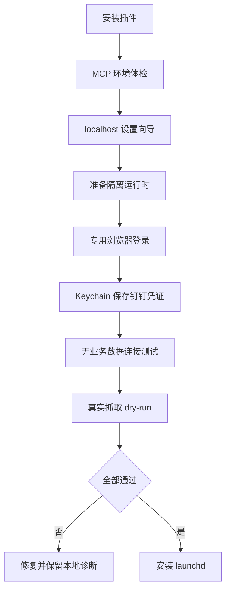
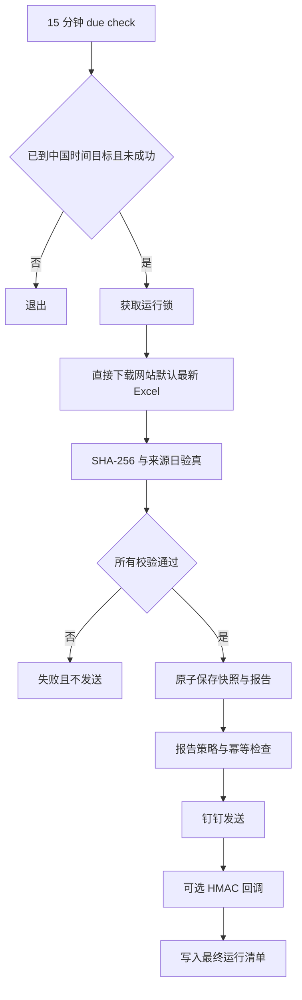

# macOS 插件架构与执行流程

本文仅针对 macOS 插件源码，不能作为 Windows 云仓 0.9.3 的验收结果。[返回当前软件说明](../README.md)。

## 组件

- `cainiao-inventory-automation-core`：配置、日期、Excel 验真、报告、Keychain、钉钉、运行账本和 launchd。
- 浏览器工作进程：使用独立 Playwright Profile 完成登录和默认报表下载。
- `cainiaoInventory` MCP：把体检、设置、运行、状态和调度暴露给 Codex。
- `cainiao-inventory-automation` Skill：规定 Codex 的调用顺序和安全边界。
- localhost 设置向导：处理敏感配置、真实 dry-run 和调度启用。

## 首次设置

## 每日执行

## 幂等与失败模型

钉钉幂等键由来源日、报告 SHA-256 和目标 Webhook 指纹组成。已成功发送的键不会再次发送，除非用户明确要求强制重发。

明确的 HTTP 或钉钉错误记录为 `failed`。请求超时或连接中断可能发生在钉钉已接收消息之后，因此记录为 `delivery_unknown`，不会自动重发。

## 调度

LaunchAgent `com.907609732.cainiao-inventory` 每 900 秒运行一次轻量检查。检查以 `Asia/Shanghai` 为准，不受 Mac 本地夏令时变化影响。22:00 错过后在 24 小时内补跑，超过窗口只记录未执行，不连续追发多日历史日报。

## 文件与权限

应用目录和业务文件使用仅当前用户可访问的权限。原始 Excel 默认保留 30 天，日志 30 天，失败页面截图和 HTML 7 天，规范化快照与运行清单长期保留。
