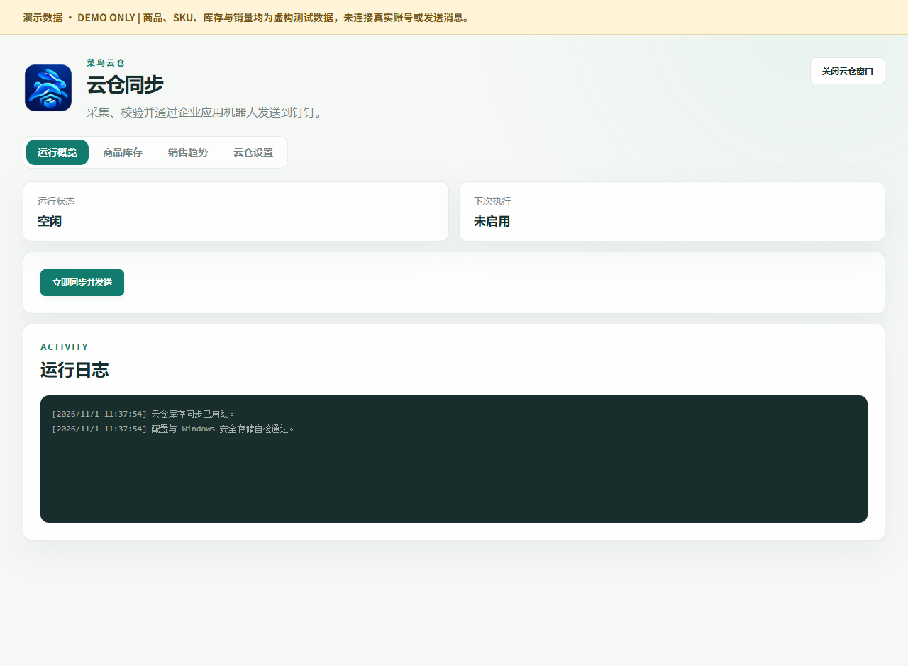
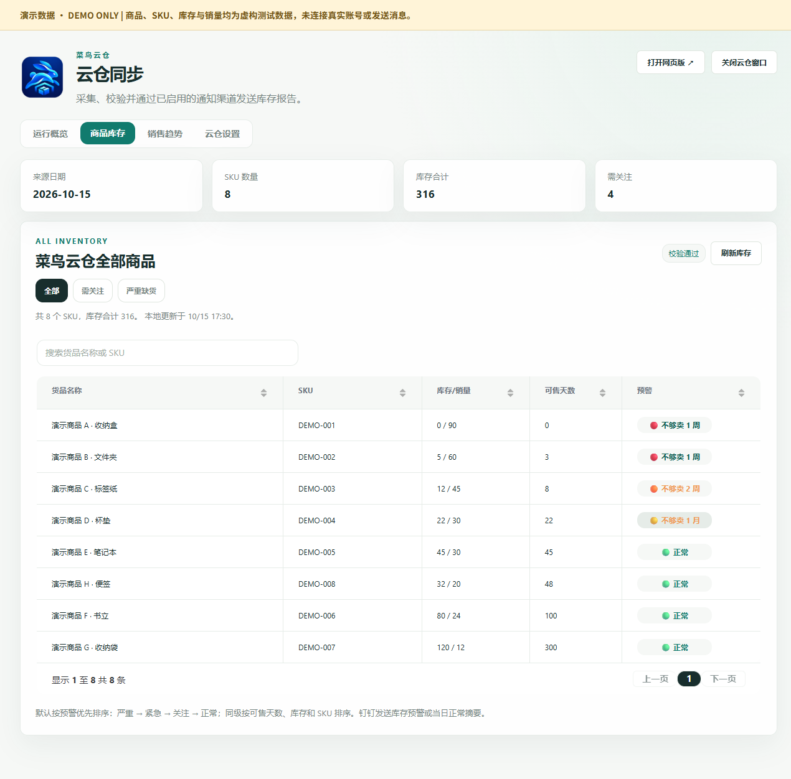
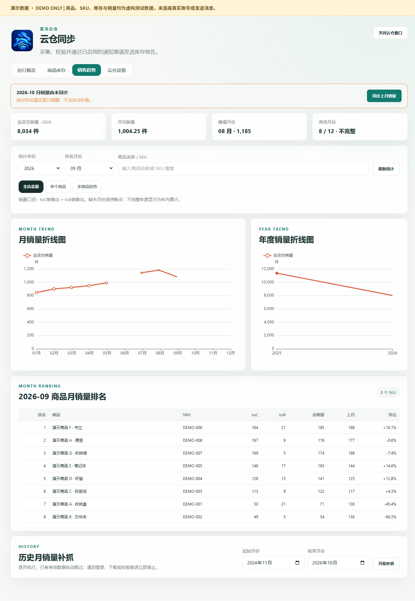
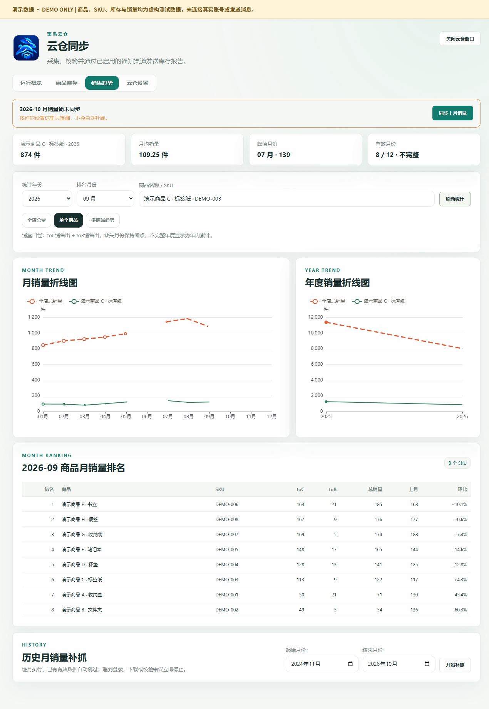
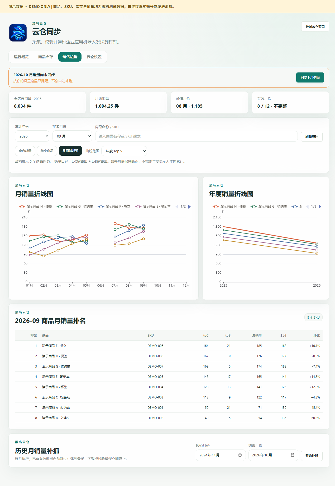
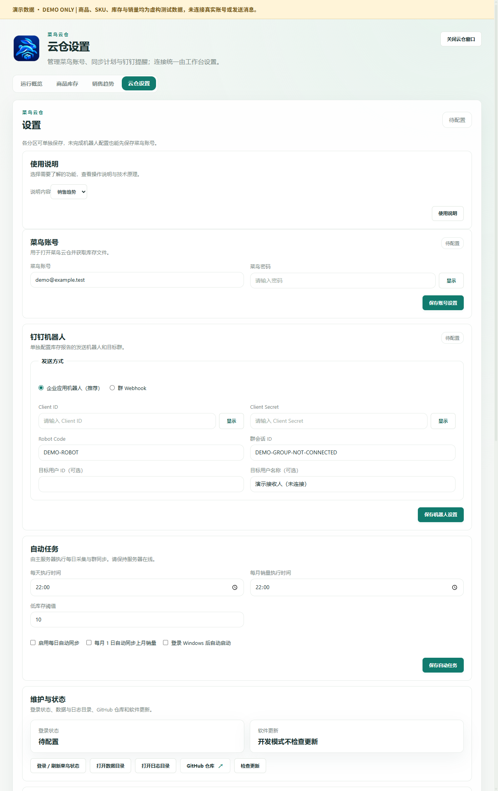

# UI and feature guide

[简体中文（默认）](ui-guide.md) | **English** · [Home](../README.en.md)

These are screenshots of the **0.10.5 source UI**, regenerated with an isolated temporary ledger. The application UI is Chinese; this document explains it in English. Every image is labeled **DEMO ONLY**. Products, SKUs, inventory, sales and account details are synthetic; no production ledger or user business screenshot was used.

## Demo dataset

| Item | Fixture |
| --- | --- |
| Products | Eight fictional products, DEMO-001 through DEMO-008 |
| Inventory | 316 units, covering severe, urgent, watch and normal alerts |
| Source date | Fixed at 2026-10-15; not live inventory |
| Sales | Invented 2025/2026 quantities, with June and October–December 2026 intentionally absent |
| Account | demo@example.test; passwords and secrets are empty |
| Schedules | Disabled; no real collection or notification was triggered |

A “validation passed” label comes from a seeded fixture and is not proof of real collection, login or delivery. Environment paths are replaced with demo placeholders. [Machine-readable demo manifest](images/ui-demo/demo-manifest.json).

## Overview



- **Task status** shows whether the backend is idle or executing a task.
- **Next run** displays the configured schedule; the demo shows it as disabled.
- **Synchronize and send now** starts collection, validation and configured delivery. The demo does not click it.
- **Logs** show startup checks and task results. Merely opening a page does not collect or send.

Windows sleep, application exit or network failure can affect in-process schedules. fnOS jobs require the NAS application to remain running.

## Inventory



Summary cards show the source date, SKU count, total stock and attention count. Search by product name/SKU, sort columns, paginate or select all/attention/severe filters. Refresh reads the saved inventory rather than downloading it again.

| Field | Meaning |
| --- | --- |
| Source date | Business date of the saved inventory snapshot |
| Stock / sales | Stock quantity compared with recent 30-day sales |
| Stock coverage | Estimated days of stock using reference sales |
| Validation | Whether saved validation matches the inventory snapshot |

Alerts use unrounded coverage, while displayed days are rounded:

| Color | Meaning | Range |
| --- | --- | --- |
| Red | Less than one week of stock | Below 7 days |
| Orange | Less than two weeks of stock | At least 7, below 15 days |
| Yellow | Less than one month of stock | At least 15, below 30 days |
| Green | Normal | At least 30 days, or no usable sales reference |

Daily sales use recent 30-day sales divided by 30, falling back to monthly outbound quantity divided by 30. Without a usable reference, coverage is shown as a dash. These colors cannot be explained solely by the quantity threshold in settings.

Notification reports in 0.10.6 retain full names and wrap at roughly twelve Chinese characters or twenty-four ASCII characters of display width. The stock-coverage header uses two lines. DingTalk SKU and stock/sales cells use smaller text without truncating digits or alerts. Actual DingTalk client rendering remains unverified; the application screenshots here are from the 0.10.5 source demo.

## Sales trends



Choose a statistical year and ranking month. Summary cards show recorded totals, the average across valid months, the peak month and valid-month count. Monthly charts keep gaps for missing data; incomplete yearly totals are cumulative recorded quantities, not complete-year comparisons.

Rankings include SKU, toC, toB, total quantity, previous month and month-over-month change. Historical backfill collects a selected month range and skips already valid months. It requires login and is not run in the demo.

The metric is **toC outbound sales + toB outbound sales**, not transaction value or revenue. Refreshing statistics reads saved data; synchronizing or backfilling starts collection.

### Single product



Select the single-product view, enter a name or SKU and refresh to inspect its summary and trends. The chart retains a store-wide reference line; the ranking uses the selected month.

### Multiple products



Compare annual Top 5, Top 10, all products or the ten steepest declines. Use the legend to select series. Declines compare the ranking month to the previous month and require consecutive valid months.

## Settings



| Section | Function |
| --- | --- |
| Cainiao account | Save a separate username/password; login challenges may require manual handling |
| Notifications | DingTalk, Feishu application bot, WeCom group bot, SMTP email and Telegram; multiple channels can be enabled |
| Schedules | Daily inventory time, monthly previous-month sales job, quantity threshold and Windows startup |
| AI Runtime | CLI, MCP and diagnostic information; shown paths are demo placeholders |
| Local web / AI access | Shared local backend and explicitly created/revocable credentials |
| Maintenance / updates | Login state, version, update status, data/log folders and update controls |
| Official links | Website, repository and external release history |

Eye buttons let users reveal individual secrets explicitly. No real secret is included in these screenshots. Windows uses secure storage; fnOS uses a separate encrypted store. Saving settings is not a delivery test.

The in-app manual and separate update/about/history cards have been consolidated into maintenance and external links. The screenshot is a source preview, so its update status says development mode does not check updates; this does not describe the stable Windows installer's update channel. fnOS updates use the matching image and FPK.

See [notifications (Chinese)](notifications.md), [date exceptions (Chinese)](date-exception-send.md), [Windows development](../windows/README.en.md) and [fnOS deployment](../deploy/fnos/README.en.md).

## Regenerate safely

From the repository root:

```powershell
npm run docs:screenshots
```

The existing script creates its own temporary profile/ledger, checks fixture counts, disables schedules and blocks Electron HTTP requests. It replaces local paths, verifies empty secret fields and writes the demo manifest. Keep this workflow isolated from real data.
