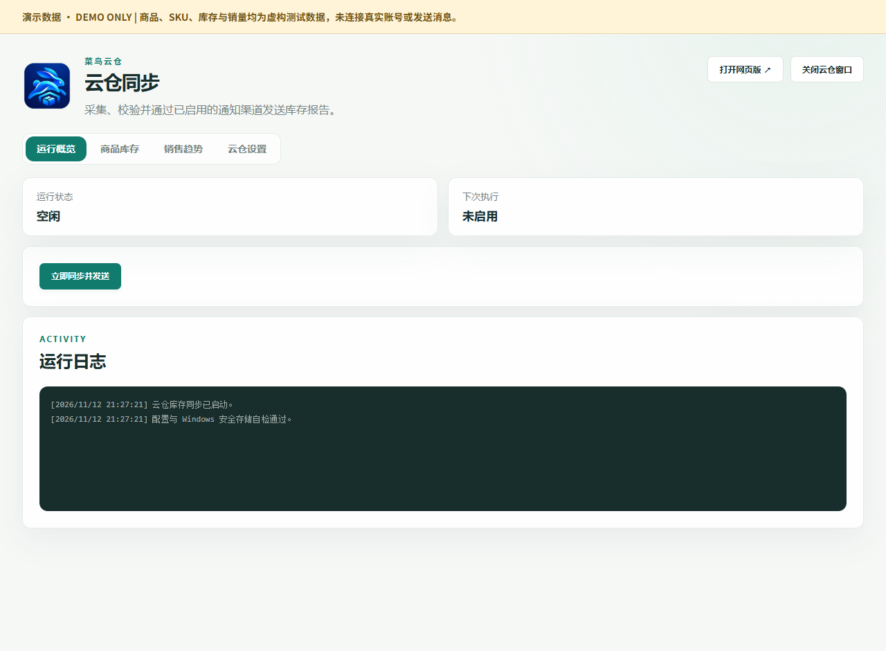
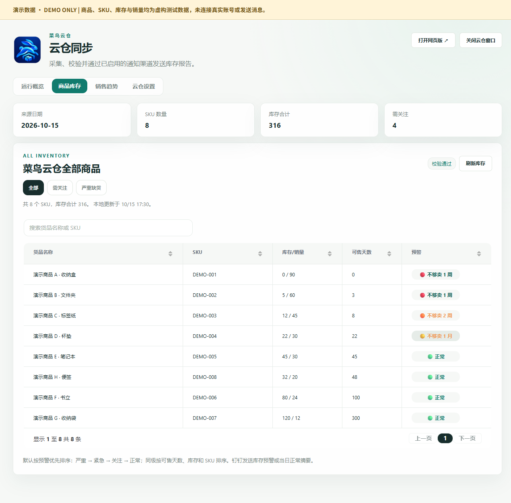
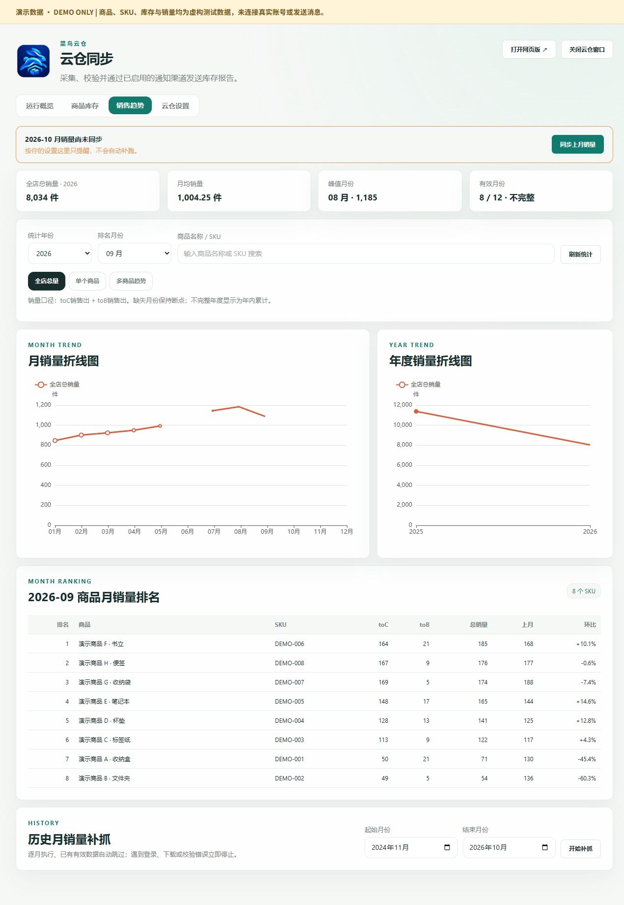
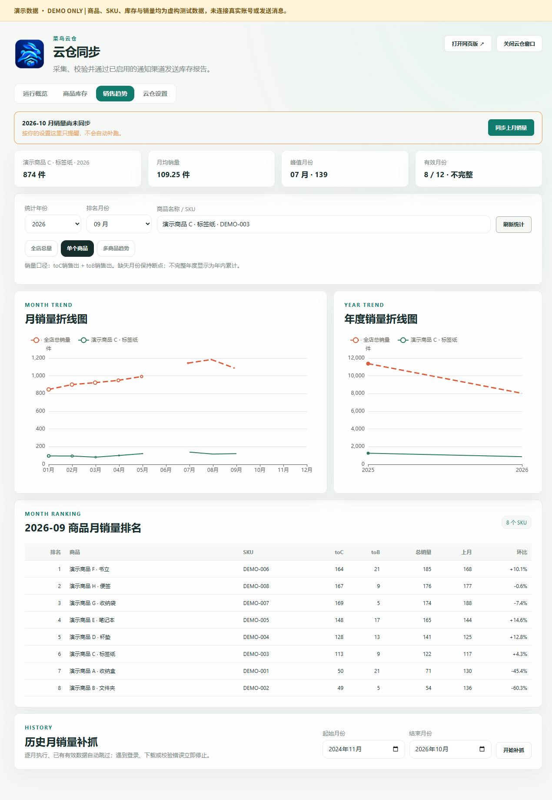
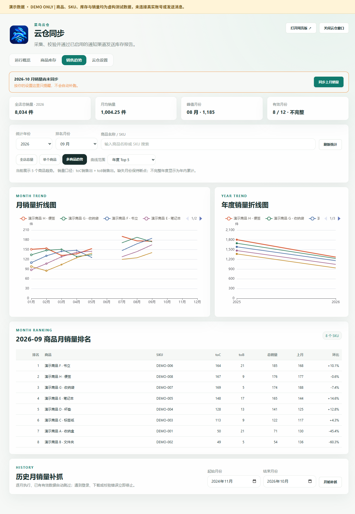
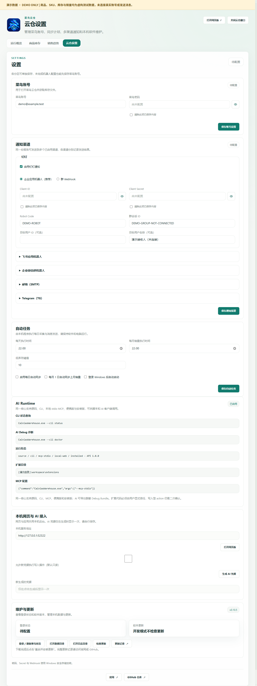

# 菜鸟云仓界面与功能演示

**简体中文（默认）** | [English](ui-guide.en.md) · [返回首页](../README.md)

本页展示 **0.10.5 源码版**的真实界面。所有图片均在独立临时账本中重新截图，商品、SKU、库存、销量和账号全部由测试脚本构造，未读取正式账本或使用用户提供的业务截图。每张图顶部都有“演示数据 · DEMO ONLY”标识。

## 演示数据说明

| 项目 | 演示内容 |
| --- | --- |
| 商品 | 8 个虚构商品，SKU 为 DEMO-001 至 DEMO-008 |
| 库存 | 合计 316 件，覆盖严重、紧急、关注、正常四种预警 |
| 库存来源日 | 固定为 2026-10-15，用于展示来源日期，不是实时库存 |
| 月销量 | 虚构的 2025 年、2026 年数据；2026 年故意缺少 6 月，10—12 月也未录入 |
| 账号 | demo@example.test，仅为测试占位，密码与密钥均留空 |
| 自动任务 | 全部关闭，未触发平台采集或钉钉投递 |

截图中的“校验通过”来自预置演示账本状态，用于说明界面呈现。截图不代表真实平台采集、登录或投递已经成功。环境路径统一使用演示占位符。

## 1. 运行概览：查看状态与任务日志



- **运行状态**：查看当前任务是否空闲或正在执行。
- **下次执行**：查看计划运行时间；截图中自动任务关闭，因此显示“未启用”。
- **立即同步并发送**：配置完成后，可手动启动库存采集、校验和按设置投递的流程。演示没有点击此按钮。
- **运行日志**：核对程序启动、配置自检以及任务各阶段的结果。打开页面不等于完成采集或发送。

日常使用时，先看状态，再查看日志中的实际结果。电脑休眠、软件退出或网络异常都可能影响进程内计划执行。

## 2. 商品库存：找到需要补货的商品



顶部汇总展示来源日期、SKU 数量、库存合计和需关注数量。表格支持商品名称 / SKU 搜索、列排序、分页，以及“全部 / 需关注 / 严重缺货”筛选。默认优先展示较严重的预警商品。

| 字段或操作 | 含义 |
| --- | --- |
| 来源日期 | 本地库存快照所对应的来源日 |
| 库存 / 销量 | 库存数量与近 30 天销量，便于对照库存压力 |
| 可售天数 | 按参考销量折算日均销量后的库存覆盖时间 |
| 校验状态 | 展示本地校验记录与库存快照的匹配结果 |
| 刷新库存 | 重新读取已保存的本地库存，不触发平台下载 |

当前预警按未取整的可售天数判断；表格中的天数显示值会四舍五入：

| 颜色 | 界面标签 | 判定范围 |
| --- | --- | --- |
| 红色 | 不够卖 1 周 | 少于 7 天 |
| 橙色 | 不够卖 2 周 | 至少 7 天、少于 15 天 |
| 黄色 | 不够卖 1 月 | 至少 15 天、少于 30 天 |
| 绿色 | 正常 | 至少 30 天，或没有可用于估算的销量 |

日均销量优先采用近 30 天销量 / 30，缺少该参考时使用月出库量 / 30；没有参考销量时可售天数显示“—”。彩色预警按可售天数展示，不能只用设置里的库存数量阈值解释颜色。

## 3. 销售趋势：查看全店月度与年度走势



- **统计年份、排名月份**：切换趋势年份和排行榜月份。
- **汇总卡片**：查看该年已录入数据的总量、有效月份月均量、峰值月份及有效月份数。
- **月销量折线图**：观察月度变化；缺失月份保留断点，不当作零销量。
- **年度销量折线图**：对照各年累计量；不完整年度是已录入月份的累计，不能直接当作完整全年同比。
- **商品月销量排名**：对照 SKU、toC、toB、总销量、上月数量和环比。
- **历史月销量补抓**：按指定范围逐月采集，已有有效数据会跳过；需要有效登录。演示不执行补抓。

截图中的 2026 年只有 8 个有效月份，6 月故意缺失。顶部的未同步提醒、图表断点和“不完整”标识都由测试数据触发。

销量口径为 **toC 销售出 + toB 销售出**，表示云仓出库销量，不等于店铺成交金额或收入。“刷新统计”只读取本地数据，“同步上月销量 / 开始补抓”才会触发采集任务。

### 单个商品：查看指定 SKU 的变化



选择“单个商品”，输入商品名称或 SKU 后刷新统计，可查看该商品的汇总和趋势。图中保留全店参考线，方便对照；下面的商品排名仍按所选月份展示。

### 多商品趋势：比较多个 SKU



“多商品趋势”提供年度 Top 5、年度 Top 10、全部商品和“下滑最严重 Top 10”。可通过图例选择关注的曲线。下滑排行比较所选排名月与上月；缺少连续有效月份时不计算下滑商品。

## 4. 云仓设置：分区配置账号、机器人与计划



截图节选到设置底部的官方链接区域，覆盖以下功能：

| 分区 | 可做什么 |
| --- | --- |
| 菜鸟账号 | 单独保存登录账号与密码；首次登录、验证码或登录失效可能需要人工处理 |
| 通知渠道 | 钉钉、飞书应用机器人、企业微信群机器人、SMTP 邮箱及 Telegram，可同时启用多个渠道；密钥加密保存 |
| 自动化任务 | 设置每日执行时间、每月上月销量任务、库存阈值和 Windows 登录后启动 |
| AI Runtime | 查看 CLI、MCP 和诊断配置；截图中的本机路径为演示占位 |
| 维护与更新 | 集中显示登录状态、当前版本及更新状态，打开数据或日志目录，检查或安装已就绪的更新 |
| 官方链接 | 访问官网或 GitHub 仓库；“更新记录”直接打开 GitHub Releases |

应用内已移除“使用说明”以及单独的“在线升级”“关于软件 / 迭代历史”卡片。完整记录在官网或 GitHub 查看；仓库仍保留可独立阅读的[功能文档](../windows/workbench/docs/feature-manual.md)。

设置中的小眼睛可按需显示单个已保存密码或密钥；默认仍隐藏。Windows 使用安全存储，飞牛使用独立加密存储。0.10.5 通知报告中的货品名称缩短至约 8 个汉字或 16 个 ASCII 字符，超出显示“…”；库存表中的完整名称、SKU 和预警数值保留。

详细字段和发送规则见[多渠道通知说明](notifications.md)。演示中各新增渠道均未启用，未发送任何真实消息。

各分区可单独保存。演示账号为 demo@example.test，机器人代码和群 ID 也带有 DEMO 标记，所有密码、Client ID、Client Secret、Webhook 和 Secret 均为空。

截图由源码演示环境生成，因此更新区显示“开发模式不检查更新”；Windows 安装版使用公开 GitHub Releases 检查更新；飞牛使用同版本镜像与 FPK 升级。独立云仓与电商工作台分别安装、配置和卸载，当前独立版不自动继承工作台账本或登录资料。

## 重新生成演示截图

先按 [Windows 开发说明](../windows/README.md) 安装依赖并准备 Electron，然后在仓库根目录执行：

```powershell
npm run docs:screenshots
```

[截图脚本](../windows/workbench/tests/capture-demo-ui.mjs) 从零创建临时 SQLite 演示账本，校验所有 SKU 都是 DEMO 前缀，关闭自动任务并拦截 Electron 的 HTTP 请求。截图后删除临时账本，只保留图片和[演示清单](images/ui-demo/demo-manifest.json)。不要将正式数据库、登录资料或用户业务截图放入本目录。
